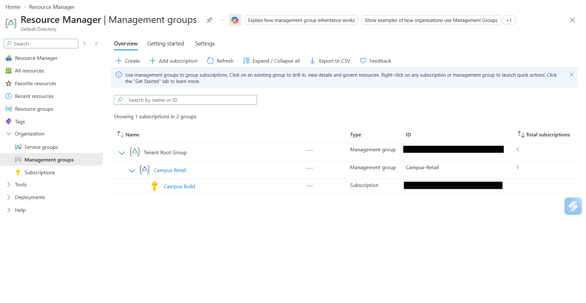
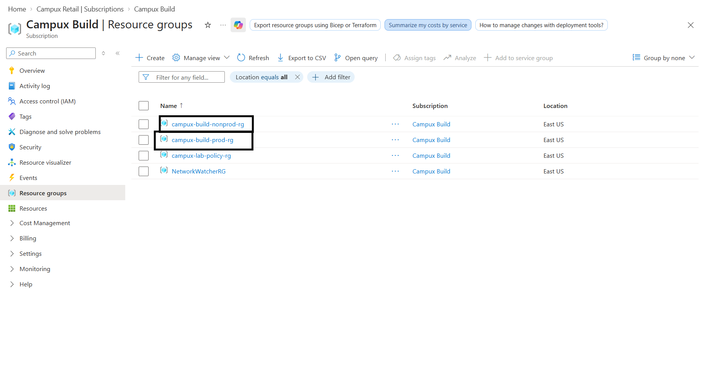
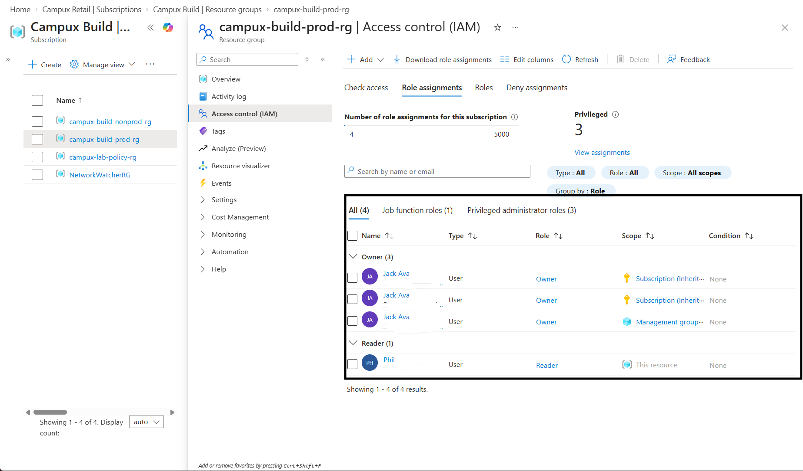
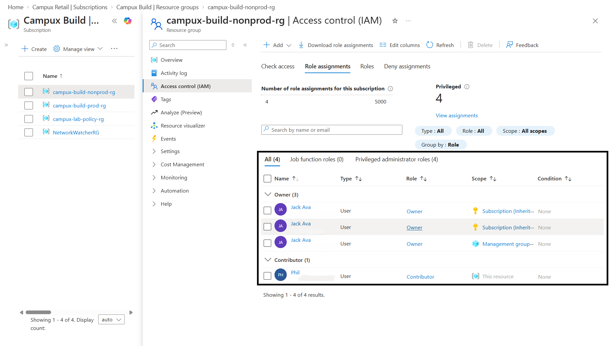
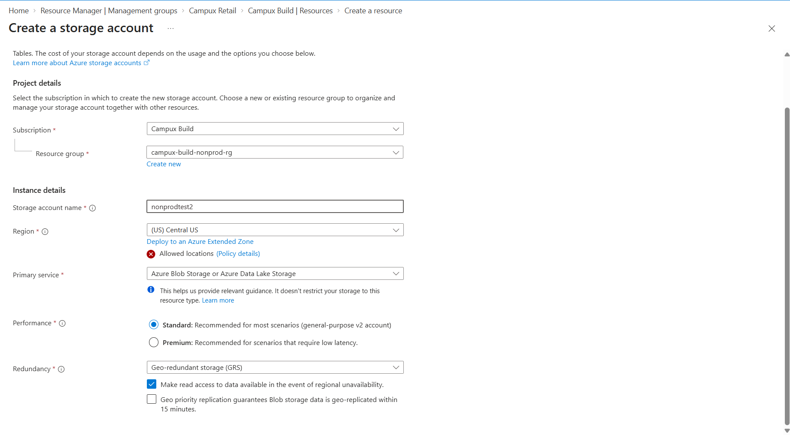
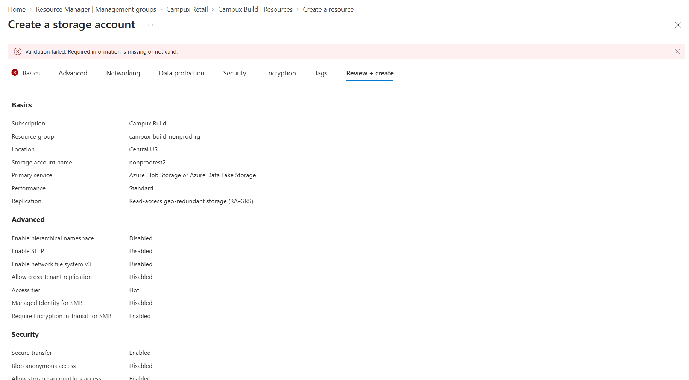
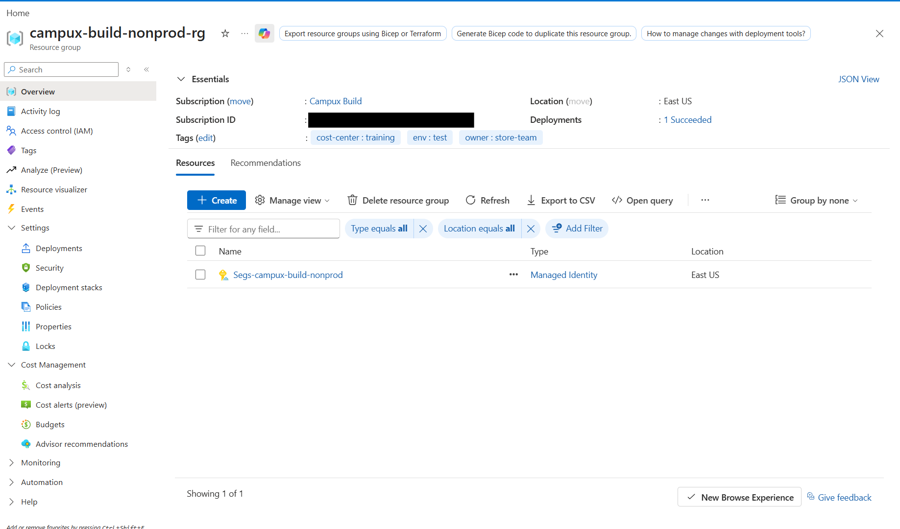
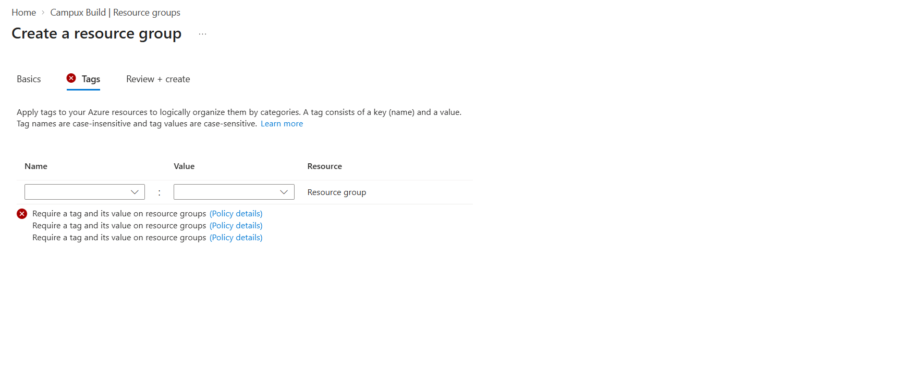
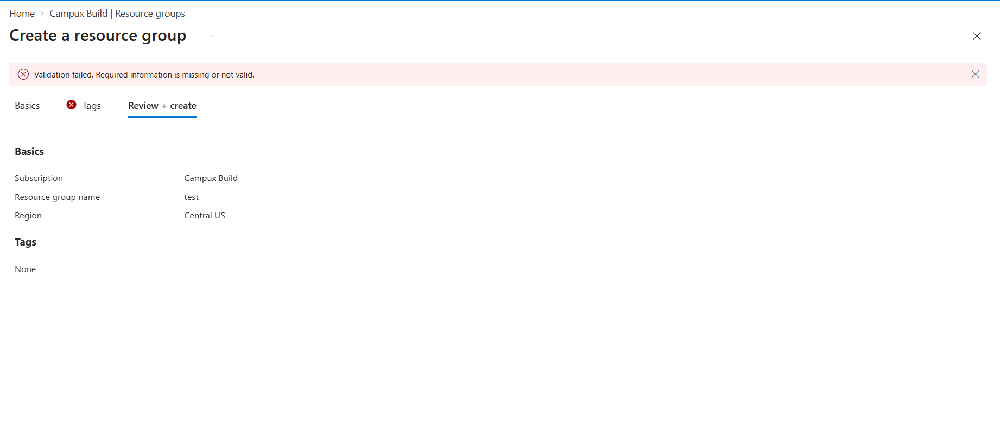
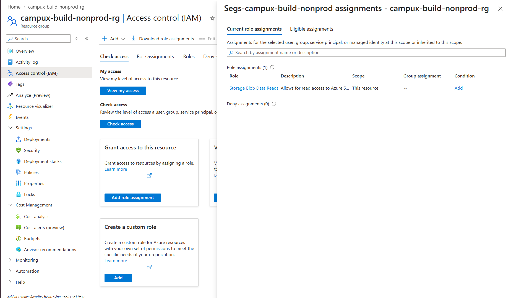

# Governed Azure Subscription: Build I

## Overview
A governed Azure environment for Campux Retail with a management group, prod and nonprod environments, role-based access, two enforced policies and a managed identity.

## Naming convention
- Management group: store name, Campux-retail
- Subscription: first build for the store , Campux-build
- Resource groups: subscription-environment(prod or nonprod)-rg, e.g. campux-build-nonprod-rg

## Hierarchy

I used 2 resource groups instead of 2 subscriptions because of the plan I currently have on my Azure account

## RBAC model
| Principal | Role | Scope | Why |
|---|---|---|---|
| Jack Ava | Owner | Management group, Subscription, Resource group | Owner is held by me |
| Phil | Reader | prod-rg | So that he won't be able to make any changes that would affect the store front |
| Phil | Contributor | nonprod-rg | So he can work efficiently in a test environment without affecting the main store front |

Phil's Contributor stops at nonprod's scope, which is what keeps him out of prod

## Policies
### Allowed locations (Deny)
It sits at the management group level so it is inherited down the estate so a new subscription or resource group is created governed instead of ungoverned.

Tried creating a resource in "Central US" when there's only an allowed region of "East US"

### Required tags (Deny)
| Tags | Value |
|---|---|
| owner |store-team |
| env | test |
| cost-center | training |

The policy applies to resource groups, requires owner, env and cost-center, and uses the Deny effect. This ensures that every resource has an owner that can be billed. Assigned at the subscription so every resource group created under it must carry the tags

## Managed identity
A user-assigned managed identity, Segs-campux-build-nonprod, lives in the nonprod resource group. It holds one role, "Storage Blob Data Reader", scoped to "campux-build-nonprod-rg", so it can do only that one job which is to only read blob data.

There is no service principal or client secret anywhere in this estate. Azure issues and rotates a managed identity's credentials itself, so there is no secret to store, leak or rotate. 

## Requesting access
As a new hire:
- Message the Owner, Jack Ava, with who needs access, which environment, which role, and why.
- The Owner checks the request against least privilege: Contributor only on nonprod, Reader on prod, Owner never.
- The Owner grants the role at resource-group scope under Access control (IAM) and confirms